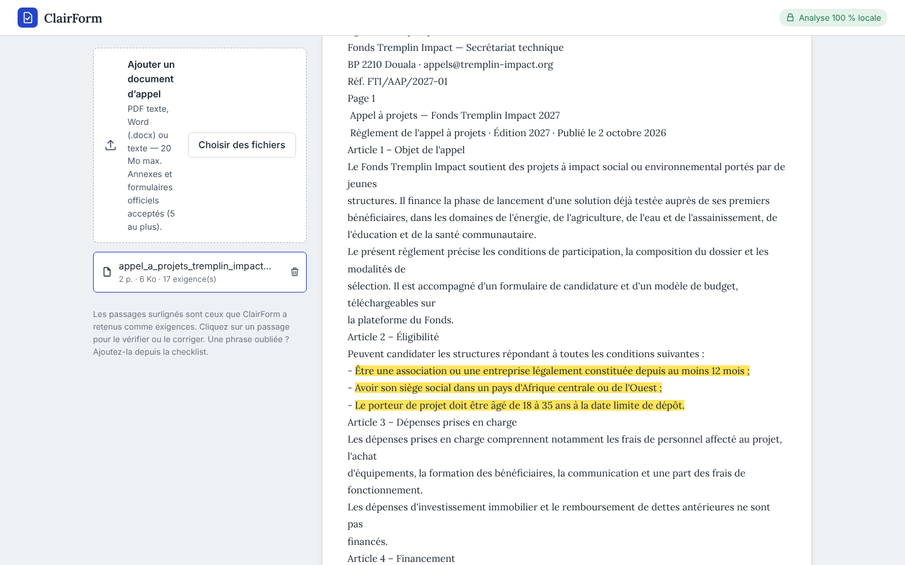

# ClairForm

**Votre dossier de candidature, vérifié pièce par pièce — sans qu’aucun document ne quitte votre ordinateur.**

ClairForm lit le règlement d’un appel à projets (subvention, concours, programme d’incubation…), en tire la liste des pièces, conditions et règles chiffrées, puis compare cette liste à vos propres documents. L’outil signale ce qui manque, ce qui est périmé et ce qui contredit le règlement. Vous exportez ensuite un rapport et un paquet de pièces renommées, prêt à déposer.



> Projet présenté au hackathon **HACK47: OFFGRID** (Devpost). Le dossier de démonstration utilise un programme, une association et des personnes inventés ; les documents d’administration portent la mention SPÉCIMEN.

---

## Le problème

Un dossier de candidature est rarement refusé pour la qualité du projet : il l’est souvent parce qu’une pièce manque, a expiré, dépasse le nombre de pages autorisé, ou parce que le budget ne tombe pas juste. Ces règles sont dispersées dans un règlement de 10 à 40 pages, et la vérification se fait à la main, la veille de la date limite.

Les outils existants pour les candidatures aident surtout à **rédiger** ou à **trouver** des financements. Ce sont des services en ligne par abonnement, pensés d’abord pour les marchés anglophones. Ils supposent d’envoyer ses pièces d’identité, statuts et relevés bancaires sur un serveur tiers.

## Ce que fait ClairForm

1. **Lit l’appel** (PDF texte, Word, .txt, .md) et construit une checklist. Chaque exigence garde la phrase et la page d’où elle vient, surlignée dans le texte, ainsi que la raison de sa sélection : formulation obligatoire, liste « Pièces à fournir »…
2. **Repère les règles chiffrées** : date limite, montant maximal, cofinancement minimal, durée maximale, nombre de pages, ancienneté maximale d’un document (« moins de 3 mois »), validité, signature, format, nombre de pièces (« deux CV »).
3. **Reconnaît vos pièces** (PDF, Word, Excel, CSV, texte, photos) : pièce d’identité, statuts/RCCM, attestation fiscale, RIB, budget, CV, lettre de soutien… puis les **rattache** à l’exigence correspondante. Vous confirmez, corrigez ou détachez chaque rattachement.
4. **Contrôle la cohérence** : total du budget différent de la somme des lignes, montant demandé au-dessus du plafond, apport propre insuffisant, montant demandé différent d’un document à l’autre, calendrier plus long que la durée autorisée, extrait trop ancien à la date limite, pièce d’identité expirée, note trop longue, signature non trouvée, doublons.
5. **Classe les prochaines actions** : d’abord corriger, puis *demander tôt* les pièces qui dépendent d’un tiers (banque, administration, partenaire), puis compléter, vérifier et confirmer.
6. **Exporte** un rapport PDF, un paquet ZIP des pièces renommées dans l’ordre de la checklist (avec un manifeste SHA-256 de chaque fichier) et les données en JSON.

ClairForm ne décide pas de l’éligibilité et ne garantit pas un financement. Les conditions (âge, pays, statut) sont **confirmées par vous**. L’outil vérifie seulement ce que vos pièces permettent de vérifier, et il indique toujours d’où vient chaque conclusion.

---

## Installation et lancement

**Prérequis :** Python 3.11 ou plus récent (exécution et tests réalisés avec Python 3.13 ; la syntaxe est aussi vérifiée avec Python 3.11). Node.js n’est **pas** nécessaire : l’interface livrée est déjà compilée.

```bash
# 1. Se placer dans le dossier du projet
cd clairform

# 2. Environnement virtuel (recommandé)
python -m venv .venv
# Linux / macOS :
source .venv/bin/activate
# Windows (PowerShell) :
.venv\Scripts\Activate.ps1

# 3. Dépendances
pip install -r requirements.txt

# 4. Lancement
python scripts/run.py
```

Ouvrez ensuite **http://localhost:8000**. Arrêtez le serveur avec `Ctrl+C`.

Options : `python scripts/run.py --port 8080 --data-dir /chemin/stockage`. Les variables d’environnement disponibles sont listées dans `backend/clairform/config.py` (`CLAIRFORM_MAX_UPLOAD_MB`, `CLAIRFORM_ALLOWED_HOSTS`, …).

### Essayer en deux minutes

- **Bouton « Découvrir avec un dossier prérempli »** : l’application génère un appel à projets et huit pièces mis en page comme de vrais documents (en-têtes, références, tableaux, signatures et cachets), puis les analyse avec le même moteur que vos fichiers. Le dossier obtenu contient 3 erreurs, une lettre manquante et un CV manquant.
- **Parcours complet à la main** : `python scripts/make_samples.py` écrit les fichiers de démonstration dans `data/samples/` (voir `data/samples/LISEZMOI.txt`). Importez `1_appel`, puis `2_pieces`, puis `3_corrections`. Supprimez les anciennes versions et confirmez les conditions : le dossier passe à « Prêt à déposer ». Le dossier `4_cas_limites` contient des fichiers qui doivent être refusés proprement : scan sans texte, faux PDF, fichier vide, exécutable.

---

## Tests

```bash
pip install -r requirements-dev.txt
python -m playwright install chromium     # une seule fois, pour les tests navigateur

python scripts/validate.py                # tout, et écrit docs/validation/RESULTATS.md
python scripts/validate.py --no-browser   # sans Playwright

# ou suite par suite, depuis backend/tests :
cd backend/tests
python -m unittest -v test_analysis test_engine test_api test_e2e_browser
```

| Suite | Ce qui est vérifié |
|---|---|
| `test_analysis` (25) | Dates et montants FR/EN, lecture d’appels (PDF français, texte anglais, Word à articles), contraintes, faits chiffrés, classement des pièces, budgets en tableau ou en texte |
| `test_engine` (38) | Refus des fichiers vides, déguisés, corrompus, chiffrés, trop gros, bombes ZIP, chemins `../`, délai de lecture ; chaque règle de contrôle ; parcours complet de l’exemple jusqu’à « Prêt à déposer » |
| `test_api` (20) | Serveur uvicorn réel : flux complet en HTTP, exports (empreintes SHA-256 du ZIP), erreurs expliquées, CSRF, Host, taille, traversée de chemin, débit, import interrompu, annulation |
| `test_e2e_browser` (5) | Chromium piloté comme un utilisateur : modales (focus, Échap), import de vrais fichiers, surlignage cliquable, rattachements, suppressions confirmées, rechargement, téléchargements, fichiers refusés, annulation d’un envoi lent, réponses serveur invalides, coupure réseau, clavier seul, mobile sans débordement, aucune erreur console ni violation CSP |
| `test_e2e_browser` en mode en ligne | Le même parcours navigateur rejoué avec la configuration d’hébergement gratuit (`CLAIRFORM_MODE=public`, `CLAIRFORM_READER=inprocess`) |

Les résultats de la dernière exécution se trouvent dans [`docs/validation/RESULTATS.md`](docs/validation/RESULTATS.md).

### Modifier l’interface

Les sources TypeScript sont dans `frontend/src`, les fichiers statiques dans `frontend/public`. Pour recompiler vers `frontend/dist` :

```bash
cd frontend && npm install && cd ..
python scripts/build_frontend.py
```

---

## Architecture

```
backend/clairform/
  app.py              API HTTP (Starlette) + middleware de sécurité + fichiers statiques
  service.py          Opérations métier : dossiers, imports, exigences, rattachements, démo
  db.py               SQLite (requêtes paramétrées, une connexion par opération)
  ingest/files.py     Validation (extension, signature, taille) + lecture dans un processus isolé
  ingest/worker.py    Lecteurs PDF (pypdf), Word, Excel, CSV, texte, images
  analysis/call_parser.py   Règlement → exigences avec provenance + faits chiffrés
  analysis/taxonomy.py      17 types de pièces (FR/EN), reconnaissance des documents
  analysis/evidence.py      Dates (délivrance, expiration), montants, budgets, signatures
  analysis/assessment.py    Rattachements, contrôles, statuts, pourcentage, prochaines actions
  export.py           Rapport PDF (ReportLab) et paquet ZIP
  samples.py          Génération des documents de démonstration
frontend/src/         React 16 (embarqué) + TypeScript compilé en modules ES, sans bundler
scripts/              run, build_frontend, make_samples, validate, capture_media, make_devpost_images
```

**Choix de conception :**

- **Déterministe et explicable.** Aucun modèle de langage : chaque exigence et chaque alerte a une source citée. Le même dossier donne toujours le même résultat, et tout fonctionne hors ligne.
- **L’utilisateur garde la main.** Les rattachements automatiques peuvent être confirmés ou rejetés. Une exigence lue par erreur peut être écartée, corrigée ou complétée par une exigence ajoutée à la main.
- **Pourcentage de couverture.** Les exigences critiques comptent double et une pièce « à vérifier » compte pour moitié. Le pourcentage est affiché avec sa règle de calcul et ne prédit aucune décision de financement.

---

## Mettre ClairForm en ligne (gratuitement)

Le mode `public` donne à chaque visiteur un espace privé, isolé des autres, et efface automatiquement les dossiers inactifs. La procédure pas à pas pour obtenir un lien de démo **gratuit** (GitHub puis Render, environ 20 minutes ; Hugging Face Spaces en solution de secours) est décrite dans [`docs/DEPLOIEMENT.md`](docs/DEPLOIEMENT.md). Les fichiers `render.yaml`, `.python-version`, `Dockerfile` et `deploy/huggingface/` sont fournis.

## En cas de problème

- **« Lecture impossible : une bibliothèque nécessaire n’est pas installée »**, ou bandeau rouge en haut de l’écran : les dépendances ne sont pas installées pour l’interpréteur Python qui lance ClairForm. Lancez `python -m pip install -r requirements.txt` avec **le même** `python` que celui de `python scripts/run.py`. Le terminal affiche au démarrage le résultat de l’auto-test de lecture.
- **Port déjà utilisé** : `python scripts/run.py --port 8080`.
- **Windows, `Activate.ps1` bloqué** : `Set-ExecutionPolicy -Scope CurrentUser RemoteSigned`, ou utilisez directement `.venv\Scripts\python scripts\run.py`.

> Correctif de cette version : la lecture des documents se faisait dans un processus isolé lancé en mode `-I`, qui ignore les bibliothèques installées « pour l’utilisateur » (`pip install --user`, le cas par défaut sous Windows sans droits administrateur). Tous les fichiers étaient alors signalés comme « endommagés ou illisibles ». Le processus de lecture reçoit désormais les mêmes chemins que le serveur, se replie sur une lecture interne si nécessaire, et une vraie erreur de configuration n’est plus jamais présentée comme un fichier corrompu. Les tests `test_engine.ReaderRobustness` couvrent ce cas.

## Limites connues

- **Pas d’OCR.** Un règlement scanné est refusé avec une explication. Une pièce scannée est acceptée, mais son contenu n’est pas lu : il faut indiquer son type. Les contrôles de date et de signature ne s’appliquent alors pas.
- **Lecture heuristique de l’appel.** Elle fonctionne sur des règlements structurés (titres, listes, formulations obligatoires en français ou en anglais). Les mises en page complexes (colonnes, tableaux) peuvent produire des exigences incomplètes. C’est pourquoi chaque exigence est surlignée dans le texte et modifiable.
- **Nombre de pages d’un .docx.** Il est lu dans les métadonnées du fichier quand Word les a enregistrées. Sinon, exportez en PDF.
- **Classeurs Excel avec formules jamais recalculées** (générés par programme) : les totaux ne peuvent pas être vérifiés, ce que l’outil signale.
- **Conversion de devises** : non gérée. Une devise différente de celle de l’appel est signalée, pas convertie.
- **Mono-utilisateur, local** : voir [`docs/securite.md`](docs/securite.md).
- Testé sous Linux avec Chromium. Firefox, Safari, Windows et macOS n’ont pas été testés dans cet environnement.

## Sécurité et confidentialité

Analyse 100 % locale, sans appel réseau sortant. Lecture des fichiers dans un processus isolé avec délai et limites. Protection CSRF et DNS rebinding, CSP stricte. Détail des contrôles et des tests associés : [`docs/securite.md`](docs/securite.md).

## Technologies tierces et licences

Starlette, Uvicorn, Pydantic, pypdf, python-docx, openpyxl, defusedxml, ReportLab, Pillow, React 16 (embarqué), polices Inter et Lora (SIL OFL). Playwright et TypeScript servent uniquement au développement. Versions et licences : [`THIRD_PARTY_NOTICES.md`](THIRD_PARTY_NOTICES.md). Développé avec l’aide d’un assistant d’IA (voir ce même fichier).

## Licence

MIT — voir [`LICENSE`](LICENSE).
